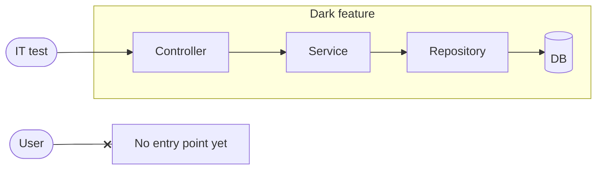

# DARK CODE

---
layout: center
class: text-center
---


<v-click>

<div class="mt-6 text-xl">

People listen to you when you show them a picture of your family.

</div>

</v-click>

---
layout: center
class: text-center
lightsOnAtClick: 1
---

# What is dark code?


<div v-click="2" class="text-3xl mt-10">

Light Theme = Dark Code

</div>

---

# A real definition

Code that's merged and deployed, but not yet visible to users.

<v-click>

<div class="mt-6">

Examples:

- New screen with no links to it
- New API endpoint nothing calls yet
- New implementation sitting next to the old one, not yet swapped in

</div>

</v-click>

---

# Why keep it dark?

<v-clicks>

- Merge to master early and often
- Ship confidently
- Integrate smoothly
- Improve engineering skills

</v-clicks>

---
layout: center
class: text-center
---


---
layout: section
---

# How do we keep it dark?

---

# Debug page

Put the new screen on the debug page. Nothing else links to it.

<div class="mt-10 text-2xl">

<a href="https://www.everydollar.com/app/debug" target="_blank">everydollar.com/app/debug</a>

</div>

---

# Local feature flag

<div class="grid grid-cols-2 gap-8 items-center">
<div class="text-2xl">

A debug-menu toggle that turns the new flow on for you, and only you.

</div>
<div>


</div>
</div>

---

# Build components in isolation

<div class="grid grid-cols-2 gap-8 mt-8 items-start">
<div class="text-center">

**Storybook** (web)


</div>
<div class="text-center">

**Widgetbook** (mobile)


</div>
</div>

---

# Why not Optimizely?

A mobile release ships whatever's in `master`. Turn the flag on later, and every phone on that release gets the half-built version.

<div class="mt-6">

```
 build ──────────────► build ──────────────► build ──────────────► done
   ▲                     ▲                                           ▲
 flag off          RELEASE CUT                                flag turned on
                  (half-built code                        (everyone on that release
                   is on devices)                          gets the half-built feature)
```

</div>

<v-click>

<div class="mt-6 text-xl">

**Don't reach for Optimizely when you're only trying to keep code dark.**

</div>

</v-click>

---

# Optimizely's job: the final wire-up

A **rollout** tool, not a hiding tool.

<v-click>

<div class="mt-6">

1. Build it dark: debug page, local flag, Storybook/Widgetbook
2. Wire up the real entry point, **behind an Optimizely flag**
3. Roll out gradually, and turn it off if something goes wrong
4. Delete the flag when rollout is done

</div>

</v-click>

---
layout: center
class: text-center
---

# The Indiana Jones Swap™


---
layout: center
class: text-center
---


---

# How the swap works

Migrating from one pattern to another? Program to a common interface first.

```
Caller → Interface → OldImplementation
```

<v-click>

Build the replacement behind the same interface, at your own pace, as small MRs:

```
Caller → Interface → OldImplementation
                    NewImplementation   ← "The New Hotness"
```

</v-click>

<v-click>

The swap is one small MR. Then delete the old one.

</v-click>

---

# Swap example: behind an interface

<div class="grid grid-cols-2 gap-6 mt-4">
<div>

```java
public interface AccountService {
    AccountResponse getAccount(Long id);
}

@Primary
@Service
class OldAccountService
        implements AccountService { ... }

@Service
class NewHotnessAccountService
        implements AccountService { ... }
```

</div>
<div v-click>

```java
@RestController
@RequiredArgsConstructor
class AccountController {
    private final AccountService accountService;

    @GetMapping("/accounts/{id}")
    AccountResponse get(@PathVariable Long id) {
        return accountService.getAccount(id);
    }
}
```

</div>
</div>

<v-click>

The controller only knows the interface. The swap is moving `@Primary`:

```java
@Service
class OldAccountService implements AccountService { ... }

@Primary
@Service
class NewHotnessAccountService implements AccountService { ... }
```

</v-click>

---

# Swap example: UI component

Rewrite the internals in a new file. Same props, same rendered output.

```tsx
export function AccountListNewHotness({ accounts, onSelect }: AccountListProps) { ... }
```

<v-click>

The swap is one line in `AccountList.tsx`:

```tsx
export { AccountListNewHotness as AccountList } from './AccountListNewHotness'
```

</v-click>

<v-click>

<div class="mt-4">

Every caller keeps importing `AccountList`. Delete the old implementation once the swap ships.

</div>

</v-click>

---
layout: section
---

# Will it work when we turn it on?

<!--
- Dark code makes it easy to merge, but it doesn't tell you whether the pieces fit together.
- Build each part separately and wire them up at the end, and things drift. The wire-up gets painful, and you can't tell whether the behavior you wanted survived.
-->

---

# The testing trophy


<!--
- Brief on the trophy: most of your confidence comes from integration tests, not from piling up unit tests. Ten seconds, the room knows it.
-->

---

# Dark code has no users



<v-click>

<div class="text-center text-xl mt-8">

Integration tests are its only users.

</div>

</v-click>

<!--
- Normal code gets tested by production every day. Dark code gets no feedback until launch day. Your tests are the only thing exercising it.
- Write ITs for the key behaviors early, before the pieces are polished. Then rework any layer, and the tests tell you if you broke something.
- Backend example: a rough working version of the service first, with ITs all the way to the database. Make it good afterward.
- Tie back to the swap: ITs are how you know The New Hotness behaves like the old version before you make the swap.
-->

---
layout: center
class: text-center
---


<div class="mt-6 text-3xl">

Questions?

</div>

<!--
- You're still listening, so it worked.
- These are tools that have worked for me, not rules. What's worked for you? What's burned you?
-->
